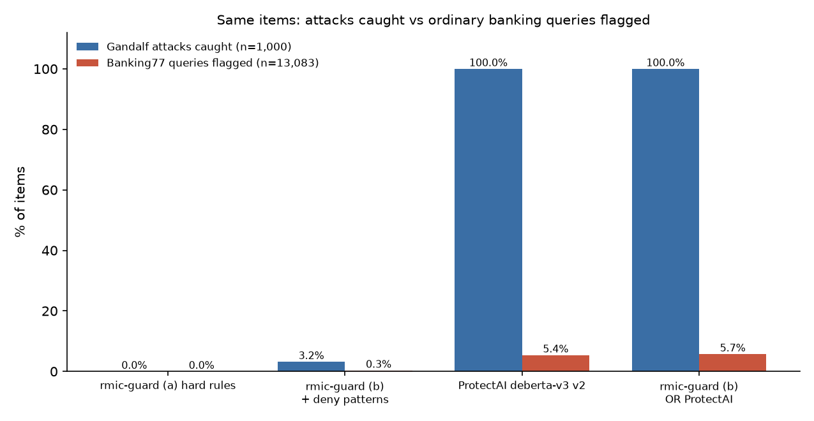

# Baseline detector on the same real-world data: results

ProtectAI run on 2026-10-26 22:11:24 at commit `9584ffae57d42fe6842d56a1eda00ad6eee671f7`.

Plan, fixed before the run: [PLAN.md](PLAN.md). Same items as [`../eval_real_data/`](../eval_real_data/results.md). Cells are k/n (rate, Wilson 95% interval). Attacks: Lakera Gandalf prompts; false positives: Banking77 queries flagged or blocked.

## Summary

| System | Attacks caught (all 1,000) | Attacks caught (test split, 112) | Banking77 false positives (all 13,083) | Banking77 false positives (test split, 3,080) |
|---|---|---|---|---|
| rmic-guard (a) hard rules | 0/1000 (0.0%, 0.0–0.4) | 0/112 (0.0%, 0.0–3.3) | 0/13083 (0.0%, 0.0–0.0) | 0/3080 (0.0%, 0.0–0.1) |
| rmic-guard (b) + deny patterns | 32/1000 (3.2%, 2.3–4.5) | 2/112 (1.8%, 0.5–6.3) | 45/13083 (0.3%, 0.3–0.5) | 9/3080 (0.3%, 0.2–0.6) |
| ProtectAI deberta-v3 v2 | 1000/1000 (100.0%, 99.6–100.0) | 112/112 (100.0%, 96.7–100.0) | 706/13083 (5.4%, 5.0–5.8) | 160/3080 (5.2%, 4.5–6.0) |
| rmic-guard (b) OR ProtectAI | 1000/1000 (100.0%, 99.6–100.0) | 112/112 (100.0%, 96.7–100.0) | 750/13083 (5.7%, 5.3–6.1) | 168/3080 (5.5%, 4.7–6.3) |

## Paired comparison with rmic-guard (b) on the same items

Discordant pairs: ProtectAI catches it and rmic-guard (b) does not / rmic-guard (b) catches it and ProtectAI does not. McNemar exact p.

| Items | ProtectAI only | rmic-guard (b) only | Both | Neither | McNemar p |
|---|---|---|---|---|---|
| Gandalf attacks (1,000) | 968 | 0 | 32 | 0 | 8e-292 |
| Banking77 queries (13,083) | 705 | 44 | 1 | 12333 | 2.2e-154 |

## ProtectAI score

ROC AUC 0.999 (Gandalf vs Banking77). At ≤1% Banking77 false positives it catches 97.7% of attacks (score ≥ 0.999948, FPR 0.99%); at ≤5%, 99.9% (score ≥ 0.817695, FPR 5.00%). The default decision (used above) is argmax, i.e. score ≥ 0.5.

## Latency per call

| System | Median (ms) | p95 (ms) |
|---|---|---|
| ProtectAI deberta-v3 v2 (local CPU, ONNX Runtime) | 23.0 | 171.2 |
| rmic-guard (b), from `../eval_real_data/` | 0.030 | 0.074 |

## Findings (written after the run; nothing was tuned)

- **ProtectAI is far better at recognising injection wording.**
  - It flagged all 1,000 Gandalf prompts (100%, 95% CI 99.6–100), including all 112 in the test
    split. rmic-guard (b) caught 32 (3.2%).
  - On the same prompts, ProtectAI caught 968 that rmic-guard (b) missed. rmic-guard (b) caught
    none that ProtectAI missed.
- **The price is about 16 times more false alarms on ordinary banking queries:** ProtectAI
  flagged 706 of 13,083 Banking77 queries (5.4%), rmic-guard (b) 45 (0.3%).
  - ProtectAI's flags spread over 59 of the 77 intents and concentrate on card and PIN questions:
    `get_physical_card` 54%, `passcode_forgotten` 46%, `pin_blocked` 39%, `card_arrival` 22%.
  - Its score separates the two sets almost perfectly (ROC AUC 0.999). A stricter threshold would
    keep 97.7% of attacks at a 1% false-positive rate, but the plan fixed the default threshold, so
    the summary uses it.
- **The two barely overlap on false alarms.** Only 1 Banking77 query was flagged by both.
  rmic-guard (b)'s 45 come mostly (38) from its `be_a_role` pattern; ProtectAI's 706 come
  from different queries. Combining them (flag if either flags) catches 100% of attacks with
  5.7% false alarms.
- **Speed.** rmic-guard (b) takes about 0.03 ms per check. ProtectAI takes 23 ms (median, p95
  171 ms) on this machine's CPU, roughly 770 times slower, but still fast enough for most agents.
- **Overlap with training data is unknown.** ProtectAI's training data was not checked against
  Gandalf. A near-perfect score on a public attack set can partly reflect having seen similar
  data.

**In one sentence:** for spotting injection wording, the existing open-source classifier is much
better than rmic-guard's deny patterns. rmic-guard's job is different: deterministic checks on
tools and arguments, which these text-only attacks never trigger. The two are complements, not
substitutes.

## Caveats (fixed in PLAN.md)

- **Training-data overlap:** ProtectAI's training data was not checked against Gandalf or Banking77; overlap would favour the detector.
- **Different jobs:** ProtectAI reads text. rmic-guard enforces tools and arguments, which are legitimate here by design; this compares detection of injection wording only.
- **Banking77** is public banking queries of undocumented provenance, not real customer traffic.
- **Single run, default settings, no tuning.**
